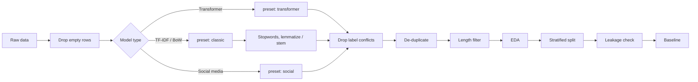

# nlp-toolkit

Utilities for cleaning text and preparing NLP datasets: normalisation, token-level
preprocessing, de-duplication, label checks, stratified splits, leakage checks, EDA
and a TF-IDF baseline.


| Notebook | Contents | |
|---|---|---|
| `01_text_cleaning.ipynb` | Individual cleaning functions and the three presets | [](https://colab.research.google.com/github/Mary-Vadi/nlp-toolkit/blob/main/notebooks/01_text_cleaning.ipynb) |
| `02_dataset_preparation.ipynb` | End-to-end dataset preparation on a toy dataset | [](https://colab.research.google.com/github/Mary-Vadi/nlp-toolkit/blob/main/notebooks/02_dataset_preparation.ipynb) |

## Workflow



## Presets

| Preset | Intended for | Lowercase | Punctuation | URLs |
|---|---|---|---|---|
| `transformer` | BERT, RoBERTa, ModernBERT | no | kept | `[URL]` |
| `classic` | TF-IDF, BoW, Naive Bayes, SVM | yes | removed | removed |
| `social` | Tweets, Reddit, comments | no | kept | `<URL>`, `<USER>` |

Pretrained encoders are trained on unnormalised text, so lowercasing or stripping
punctuation and stopwords usually hurts them. For stylometric tasks such as
machine-generated text detection or authorship attribution, surface features are
part of the signal; keep cleaning minimal and apply the same steps to every split.

## Installation

```bash
pip install git+https://github.com/Mary-Vadi/nlp-toolkit.git
```

For development:

```bash
git clone https://github.com/Mary-Vadi/nlp-toolkit.git
cd nlp-toolkit
pip install -e ".[dev]"
```

## Usage

```python
from nlp_toolkit import CleaningPipeline

pipe = CleaningPipeline.from_preset("classic")
pipe("Check THIS out!!! https://x.com &amp; it's sooooo great")
# 'check this out it is soo great'

# inspect intermediate output
for step, text in pipe.trace("It's <b>GREAT</b>"):
    print(f"{step:30} {text}")
```

Custom pipeline:

```python
from functools import partial
from nlp_toolkit import CleaningPipeline, cleaning as C

pipe = CleaningPipeline([
    C.unescape_html,
    C.remove_html_tags,
    partial(C.replace_urls, token="<URL>"),
    C.to_lowercase,
    C.normalize_whitespace,
])
```

Dataset preparation:

```python
import nlp_toolkit.dataset as D
from nlp_toolkit import CleaningPipeline
from nlp_toolkit.features import baseline_classifier

df = D.load_text_data("data/raw/my_data.csv")
df = D.drop_empty(df)
df = D.clean_column(df, CleaningPipeline.from_preset("transformer"))
df = D.drop_label_conflicts(df)
df = D.remove_duplicates(df)
df = D.filter_by_length(df, min_words=3)
D.check_labels(df)

splits = D.split_dataset(df, val_size=0.1, test_size=0.1)
D.check_leakage(splits)  # expect all zeros
D.save_splits(splits, "data/processed", fmt="jsonl")

model, report = baseline_classifier(splits["train"], splits["test"])
```

## Modules

| Module | Contents |
|---|---|
| `cleaning` | String-level functions (`str -> str`): HTML, URLs, emails, mentions, hashtags, emojis, Unicode normalisation, contractions, repeated characters, punctuation, accents |
| `pipeline` | `CleaningPipeline` and the three presets |
| `preprocessing` | Tokenisation, stopwords, stemming, lemmatisation, n-grams |
| `dataset` | Loading, de-duplication, label conflicts, length filtering, language detection, splitting, leakage checks |
| `eda` | Per-text statistics, top n-grams, plots |
| `features` | TF-IDF vectoriser and logistic regression baseline |

Raw and processed data go in `data/raw/` and `data/processed/`; both are git-ignored.

## Tests

```bash
pytest
```

## License

MIT
